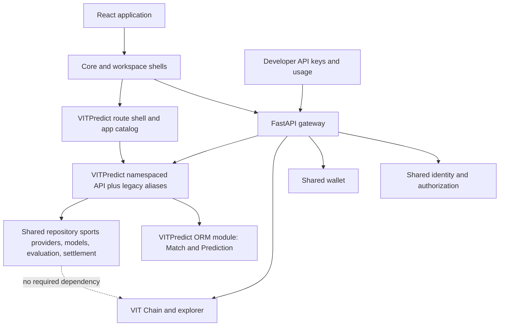
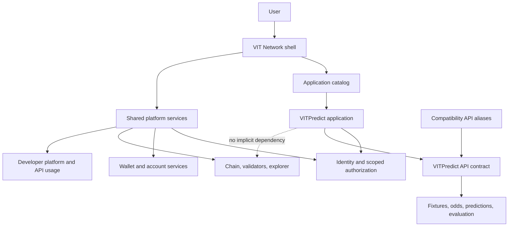

# VIT Network Application Boundaries

Status: initial application boundary implemented; production rollout pending  
Audit baseline: 2026-10-18

## Product boundary

VIT Network is the ecosystem and shared platform. VITPredict is an application in that ecosystem. This repository currently ships both through one gateway and one React bundle; application ownership is established through manifests, route namespaces, permissions, and isolated navigation rather than a new deployment or a database split.

## Current implementation after this change

The React bundle and FastAPI gateway remain shared deployments, but `/apps/vitpredict/*` has a distinct shell, navigation, dashboard, and API namespace. The ecosystem `/dashboard` is network-focused and `/applications` discovers VITPredict plus published developer apps. Legacy `/matches`, `/predictions`, `/odds`, `/analytics-studio`, and `/verification` routes redirect to VITPredict; legacy API routes remain mounted for existing clients. `Match` and `Prediction` are now declared in `app.modules.vitpredict.models` and re-exported from `app.db.models` with unchanged table names and fields. Sports provider services, result jobs, and some result/affiliate models remain shared-repository modules pending dependency-by-dependency extraction.

## Target boundary

VITPredict may share a deployment and database with the gateway. Shared authentication does not grant unrestricted access to other application APIs. Any future chain integration must be explicitly declared by VITPredict and justified by a product requirement.

## Capability ownership matrix

| Capability | Current owner / location | Intended owner | Dependencies | Migration and compatibility | Existing verification |
|---|---|---|---|---|---|
| Consensus, blocks, transactions, finality | `vit_chain/`, `backend/app/modules/blockchain/` | VIT Network core | Database, peer transport, validator keys | No sports-domain dependency; no table changes | `vit_chain/tests/`, chain integration tests |
| Shared identity, sessions, authorization | `backend/app/modules/identity/`, `/api/auth/*` | VIT Network core | User store, token/signature services | Shared auth remains; add app-specific scopes without widening existing roles | Identity/auth tests |
| Wallet and network account services | `backend/app/modules/wallet/` | VIT Network core | Identity, payment providers, chain where explicitly used | Preserve current paths and balances | Wallet tests |
| Developer keys, plans, usage, webhooks | `backend/app/modules/developer/` | VIT Network core | Identity, quota/billing store | Legacy keys remain unscoped; app-scoped keys require a reviewed app and enforce app/scope boundaries | Developer key and scope tests |
| Application manifests | `backend/vit_protocol/application.py` | VIT Network core contract | Developer identity, scoped permissions | Reuse manifest validator; VITPredict manifest is `app:vitpredict` | `tests/test_vit_application_manifest.py` |
| Application discovery | `/api/apps`, `frontend/src/lib/appRegistry.ts`, `/applications` | VIT Network core | Manifest, published developer app records, app health | VITPredict is built-in; external apps appear only after admin approval and publish | Developer lifecycle API tests; frontend build |
| Fixtures, match discovery, match history | `/api/apps/vitpredict/matches/*`, legacy `/api/matches/*`, `app.modules.vitpredict.models.Match` | VITPredict | Sports providers, shared persistence | Keep legacy API aliases and existing `matches` table | Sports route tests; namespace parity test |
| Odds ingestion and normalization | `/api/apps/vitpredict/odds/*`, legacy `/api/odds/*`, sports provider services | VITPredict | Provider credentials, cache, fixtures | Existing provider adapters and legacy paths retained | Odds/provider tests; API contract not fully sampled |
| Prediction generation and explanations | `/api/apps/vitpredict/predict/*`, legacy `/api/predict/*`, VITPredict `Prediction` table | VITPredict | Fixture/odds inputs, AI/model services, scoped developer keys | Existing prediction behavior, history, and consumer contracts preserved | Prediction tests; app-scope tests |
| Result verification and model evaluation | `app.modules.sports` models, evaluation services, results routes | VITPredict | Provider observations, match/prediction records | Keep existing tables and audit history; no destructive migration | Result verification/evaluation tests |
| Prediction settlement | `settlement_service.py`, runtime and supervised tasks | VITPredict | Verified match outcomes, prediction records | Recent-match GET no longer runs sync/settlement; retain existing settlement task | Read-no-side-effect and settlement tests |
| Core and sports frontend pages | `/dashboard`, `/applications`, `/apps/vitpredict/*`; legacy redirects | Core shell hosts app; VITPredict owns sports UX | Shared identity and API client | Existing history retained; prediction and odds routes use auth gate | Frontend production build passes; browser runtime unavailable |
| Notifications, audit, observability | Shared backend modules and shell components | VIT Network core; VITPredict owns event definitions | Identity and event infrastructure | Keep generic infrastructure; namespace app events/config | Module tests; app-isolation coverage needed |

## Resolved violations and remaining work

1. **Resolved:** public/core navigation no longer presents Matches or Predictions as ecosystem top-level features; `/applications` and the workspace registry launch VITPredict.
2. **Resolved:** app-owned matches, prediction, odds, analytics, dashboard, leaderboard, and attestation aliases are mounted beneath `/api/apps/vitpredict`; existing paths remain compatible.
3. **Resolved logically:** `Match`/`Prediction` declarations moved to `app.modules.vitpredict.models`; tables and data were not renamed or migrated.
4. **Resolved:** recent-match GET no longer synchronously invokes fixture synchronization or settlement. Settlement remains in its supervised task/runtime path.
5. **Resolved:** the generic manifest, public app catalog, DeveloperApp registration/review/publish lifecycle, and VITPredict workspace entry are connected.
6. **Resolved for developer keys:** VITPredict app keys carry an app ID and reviewed scopes; middleware denies cross-app use and missing route permissions. Shared JWT sessions continue to use existing per-route authentication and user ownership checks.
7. **Open:** football provider clients, scheduled ingestion/results, some sports result/affiliate models, and evaluation services remain in shared repository paths. Extract only after import/migration and provider-job dependency mapping.
8. **Open:** developer API keys for other external apps remain legacy-unscoped; the new scope enforcement applies to app-bound keys and VITPredict namespace. Extending it globally requires a compatibility/version policy.
9. **Open:** VITPredict still shares the gateway process and database by design; independent deployment is not yet required or implemented.
10. **Open:** legacy accumulator, rollover, bankroll, and in-play features were not reclassified or moved because the product boundary explicitly excludes betting actions; inventory each before exposing them inside VITPredict.

## Compatibility and migration rules

- Keep existing ORM table names, columns, and data in place during this boundary phase.
- Keep legacy API routes available while adding app-owned route aliases; do not silently change response schemas.
- Keep shared login and identity infrastructure; app-specific permissions must be explicit and least-privilege.
- App-scoped API keys may only invoke their registered application and only the reviewed route scopes.
- Preserve existing prediction, evaluation, result-verification, developer, and chain behavior with regression tests.
- Do not add wager placement, staking, or betting-account functionality to VITPredict.
- Do not make prediction workflows depend on blockchain finality without a separately documented product requirement.

## Evidence limits

The audit traced primary React routes, gateway mounts, ORM ownership, manifest and developer-app workflows, API-key scope enforcement, and settlement entry points. It did not execute every API operation, inspect every third-party provider contract, or complete rendered browser review. Browser validation is blocked in this container because Playwright Chromium cannot load `libatk-1.0.so.0`; live requests also encountered transient 429/503 responses after the initial successful admin probes. New migrations and UI/API changes have only local test/build evidence; deployment has not been performed.